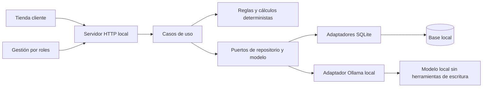

# Arquitectura actual

ChangeLab usa un monolito modular con Node.js y SQLite.

| Capa             | Responsabilidad                                                  | Ejemplos                                                 |
| ---------------- | ---------------------------------------------------------------- | -------------------------------------------------------- |
| domain           | Tipos, validaciones de precios y cálculos                        | catalog.ts, impact.ts, tax.ts                            |
| application      | Orquestación de reglas y repositorios                            | proposals.ts, commerce.ts, refunds.ts, reconciliation.ts |
| infrastructure   | SQLite, credenciales y proveedor IA                              | store.ts, commerce-store.ts, cash-store.ts, ollama.ts    |
| server.ts        | Composición, HTTP, sesiones, origen/CSRF y traducción de errores | makeServer                                               |
| public           | Interfaz y peticiones al servidor                                | app.js, shop.js, storefront.js                           |
| tests/evaluation | Pruebas automáticas y evaluación del modelo                      | commerce-journey.test.ts, business-run.ts                |

## Validación y permisos

El servidor valida las entradas y comprueba el rol de la sesión. Cuando el flujo exige revisión independiente, compara la identidad del autor con la del revisor. La publicación vuelve a comprobar el margen y la versión de los datos.

Ollama recibe contexto acotado. El servidor valida la respuesta antes de presentarla y reserva las escrituras a los casos de uso autorizados. PDF.js extrae texto en un proceso hijo con límites de tiempo, memoria y tamaño. El proceso se ejecuta con los permisos del servicio.

## Persistencia y dinero

La aplicación guarda precios y costes en céntimos enteros. Los pedidos conservan los importes de cada línea al comprar, incluida la base y el IVA. Si un registro antiguo carece de algún dato, la interfaz lo indica.

Una devolución de mercancía, un reembolso y una rectificación fiscal son operaciones distintas. Cuando un caso de uso cambia varios registros, SQLite agrupa las escrituras en una transacción. Por ejemplo, una recepción guarda conjuntamente el movimiento de almacén y el estado de la compra. Las referencias de operación permiten reconocer reintentos en los flujos que las requieren.

## Alcance operativo

ChangeLab está preparado para una instalación local con SQLite. Las pruebas de integración cubren recorridos de negocio, permisos y persistencia. La guía de [copias y recuperación](copias-locales.md) describe cómo comprobar una restauración en un destino separado.

La vista de almacén muestra las últimas 50 operaciones de cada listado de recepciones y movimientos. La auditoría filtra y pagina las 1.000 entradas más recientes. Los registros anteriores se conservan en SQLite. La consulta del historial completo desde la interfaz requeriría filtros y paginación en el servidor. La automatización de los recorridos principales en navegador complementaría las pruebas HTTP. Un despliegue compartido requeriría definir el acceso y la conservación de copias fuera del equipo.
