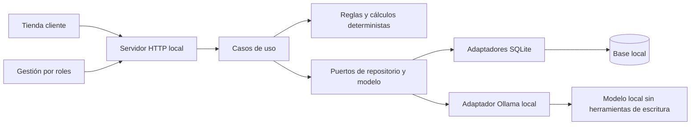

# Arquitectura actual

Estado al 28/10/2026. Monolito modular local, no arquitectura distribuida. Implementación propia con referencias M0001/M0021; la elección de SQLite/Node HTTP y los límites del caso son decisiones del proyecto.

| Capa             | Responsabilidad                                                  | Ejemplos                                                 |
| ---------------- | ---------------------------------------------------------------- | -------------------------------------------------------- |
| domain           | Tipos, validaciones de precios y cálculos                        | catalog.ts, impact.ts, tax.ts                            |
| application      | Orquestación de reglas y repositorios                            | proposals.ts, commerce.ts, refunds.ts, reconciliation.ts |
| infrastructure   | SQLite, credenciales y proveedor IA                              | store.ts, commerce-store.ts, cash-store.ts, ollama.ts    |
| server.ts        | Composición, HTTP, sesiones, origen/CSRF y traducción de errores | makeServer                                               |
| public           | Presentación, formularios y peticiones; no autoridad de negocio  | app.js, shop.js, storefront.js                           |
| tests/evaluation | Tests reproducibles y evaluaciones reales separadas              | commerce-journey.test.ts, business-run.ts                |

## Límite de confianza

El servidor valida entradas aunque el navegador ya las marque. Roles y separación autor/revisor se resuelven con identidad autenticada, no con botones ocultos. El LLM recibe contexto acotado y devuelve JSON no confiable; no recibe acceso SQL ni ejecuta herramientas. La simulación y el publicador vuelven a validar reglas. Cambiar un modelo no cambia las reglas del publicador.

## Persistencia y dinero

Precios/costes en céntimos enteros; el precio de catálogo es neto. Nuevos pedidos guardan base/IVA/total y precio/coste de sus líneas. Históricos carecen de algunos datos: se muestran advertencias y no se inventa una reconstrucción fiable.

Pedidos, movimientos, caja y documentos son registros diferentes. Devolver mercancía no devuelve dinero; rectificar documentos no cancela un pedido. Los reembolsos conservan cobros originales. Comandos relacionados usan transacciones SQLite; referencias y requestId protegen los reintentos. No hay atomicidad con bancos o proveedores externos.

## Deuda técnica explícita

Servidor de composición todavía grande. Pedidos, almacén, facturación y conciliación tienen módulos de interfaz separados; las rutas aún no son persistentes. Caja/reembolsos validan JSON al leer; otros adaptadores conservan validación parcial. Consultas sin paginación de servidor y algunos listados de últimos50. Pruebas HTTP no equivalen a automatización completa de interfaz. Copia/restauración SQLite verificadas; siguen pendientes operación compartida, retención externa y despliegue. No se afirma cobertura total de ataques.

operation_documents conserva compras/incidencias/devoluciones/importaciones; savepoints permiten componer recepciones y cambios de estado en una sola operación. El LLM local propone selecciones/borradores y filas; nunca ejecuta SQL o escrituras. PDF.js se ejecuta en proceso hijo acotado; no es un aislamiento completo de seguridad.

Hito44: rutas operativas separadas en http/operations-routes.ts y validación de lecturas en infrastructure/operation-records.ts. Docker local con volumen y usuario sin privilegios; ver docker-local.md. La explicación de resultados incompletos evita llamar al modelo. Los adaptadores antiguos y paginación siguen como deuda explícita.
