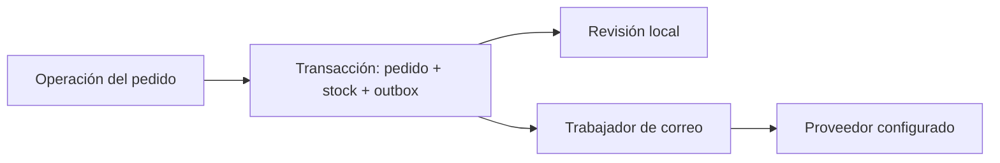

# Correos transaccionales y datos de expedición

Estado: 05/11/2026. Servicio saliente implementado y comprobado en modo de revisión local. No se han enviado correos externos ni se ha configurado una cuenta real.

## Qué ve cada persona

- Cliente: en Mis pedidos aparecen transportista, referencia, fecha de tramitación, recogida real, dirección original de entrega y una ventana orientativa. El enlace de seguimiento aparece únicamente si oficina facilita una URL HTTPS pública. Las fechas se estiman desde la recogida, con dos a cuatro días laborables en Europe/Madrid, sin calcular festivos ni consultar al transportista.
- Ana y Antonio: nuevo apartado Correos a clientes, con contenido, destinatario, estado, intentos y descarga `.eml`. Pueden preparar una copia de pedidos anteriores para revisar, sin ordenar un envío externo.
- Mario: no tiene acceso a la bandeja ni a sus rutas. Preparar un paquete no genera un correo que diga enviado; la salida real se confirma al recogerlo.

## Eventos y consistencia

Confirmar la compra prepara su confirmación. Confirmar la recogida prepara el aviso de envío. Cancelar prepara una confirmación de cancelación que no promete un reembolso automático. Las plantillas se construyen con los datos guardados del pedido, sin generación libre por un modelo.



Un puerto opcional del repositorio coordina la cola desde los casos de uso de compra y cambio de estado. En el servidor se conecta con la tabla SQLite `mail_outbox`. El evento y el pedido forman una clave única: repetir una petición no prepara mensajes duplicados. Si falla la escritura de la cola, se revierte también la operación empresarial. La llamada de red se hace después, sin mantener una transacción de inventario abierta.

Los mensajes guardan una instantánea del destinatario y contenido. Un cambio posterior del perfil no reescribe correos ya preparados. El envío real no confirma recepción en el buzón: la interfaz distingue aceptación por el proveedor y revisión local.

## Configuración actual y activación

Por defecto:

```dotenv
CHANGELAB_MAIL_PROVIDER=preview
CHANGELAB_MAIL_ENABLE_SEND=false
```

El servidor guarda los correos nuevos como mensajes de revisión en la misma transacción del pedido. El modo se conserva al activar una cuenta después. Antes de habilitar el trabajador real sobre una base creada con una versión anterior, revisa sus pendientes: las versiones que convertían los mensajes por intervalos podían haber dejado alguno pendiente al apagar el servidor.

El adaptador externo disponible es Resend, utilizando `fetch` de Node; no se ha añadido un SDK ni dependencia de correo. Para activarlo se requiere remitente verificado, clave privada, URL pública HTTPS de la tienda y habilitación explícita:

```dotenv
CHANGELAB_MAIL_PROVIDER=resend
CHANGELAB_MAIL_ENABLE_SEND=true
CHANGELAB_MAIL_FROM=pedidos@tu-dominio.com
CHANGELAB_MAIL_API_KEY=tu-clave-privada
CHANGELAB_SHOP_URL=https://tu-tienda.com/mis-pedidos
```

Estos valores se ponen en `.env`, ignorado por Git. Nunca en código ni en la interfaz. La configuración incompleta conserva el modo de revisión.

El proceso web guarda los mensajes; la entrega externa se ejecuta en un trabajador separado:

```sh
npm run mail:worker
```

`--once` permite procesar un lote y terminar. Por defecto usa la base habitual; `CHANGELAB_DB` permite seleccionar otra base existente. La configuración por sí sola no inicia un trabajador ni prueba que el remitente haya sido verificado por el proveedor.

## Reintentos y límites

La cola guarda intentos, próxima ejecución, errores acotados, aceptación del proveedor y un arrendamiento de trabajo. Dos trabajadores no pueden reclamar simultáneamente el mismo mensaje. Se reintentan errores transitorios con espera creciente y un máximo automático de cinco intentos; los rechazados permanentes quedan bloqueados para revisar.

Cada petición usa el identificador persistente del mensaje como clave de idempotencia. La [documentación de Resend](https://resend.com/docs/dashboard/emails/idempotency-keys) establece una conservación de 24 horas; aquí se usa un límite conservador de 23 horas desde el primer intento. Si una entrega queda interrumpida fuera de esa ventana, no se reenvía automáticamente: requiere revisar el proveedor. Esto reduce duplicados, sin prometer entrega exactamente una vez en cualquier fallo externo.

Se ha contrastado el contrato de envío con la [API oficial](https://resend.com/docs/api-reference/emails/send-email). Las pruebas usan un transporte controlado: no equivalen a una entrega real con una cuenta verificada. No se ha implementado recepción de buzón, notificaciones de rebote, confirmaciones de entrega por webhook ni integración con empresas de transporte.

Los mensajes se guardan en la base privada del proyecto y la consulta de oficina muestra los últimos 100.
